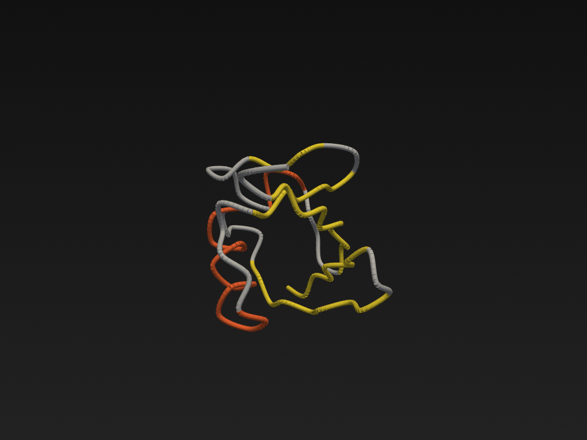
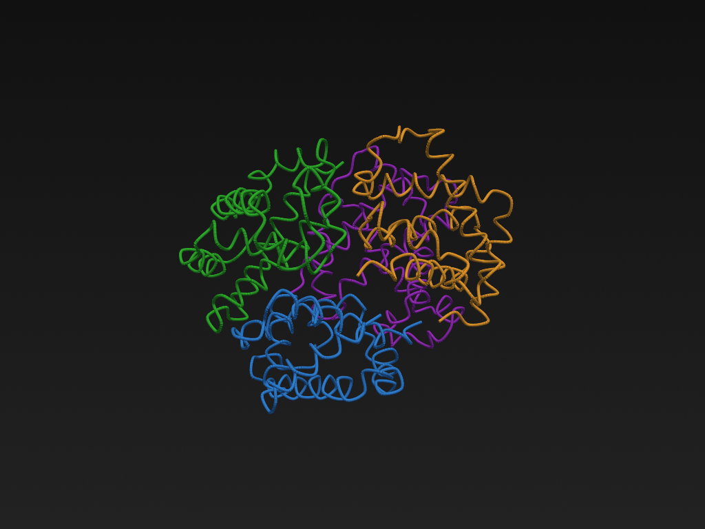

# Protein Studio

A Blender-like molecular visualization and editing desktop application
with an embedded Python scripting console — built on **PySide6 + PyVista
+ VTK**.




## Why?

Pymol, ChimeraX, VMD and Blender+Molecular Nodes are all great tools.
Protein Studio is an experiment in keeping the *scriptability* of
Blender (every operation has a Python binding) while staying
self-contained, easy to read, and easy to extend. The whole UI is ~1000
lines of code and the rendering pipeline is a single PyVista plotter.

## Features

- **PDB loading** (ATOM / HETATM / HELIX / SHEET / multi-model).
- **Seven representations** — `cartoon`, `ball_and_stick`, `ribbon`,
  `surface`, `points`, **`esp_surface`** (red-white-blue
  electrostatic), **`hbonds`** (dashed lines).
- **Seven color schemes** — `element`, `residue`, `chain`, `secondary`,
  `bfactor`, `uniform`, **`alphafold_plddt`** (royal-blue / cyan /
  amber / brick-red AlphaFold palette).
- **Distance measurement** between any two atoms via
  `D.distance(obj, chain_a, resnum_a, name_a, chain_b, resnum_b, name_b)`.
- **MD trajectories** (DCD / XTC / NC / TRR) via MDAnalysis —
  `D.load_trajectory(name, top, traj)` then `D.frame(name, i, obj)`.
- **AlphaFold / Boltz-2** automatic pLDDT colouring via
  `D.load_alphafold(path)`.
- **Docking poses** — Vina PDBQT and EquiScore directory auto-detect,
  per-pose rank-based colouring via `D.load_docking(path)`.
- **Blender-like layout** — Outliner (left), Viewport (centre),
  Properties (right), Python Console (bottom).
- **Embedded Python console** — full access to a `D` object that
  exposes load / save / mutate / render operations.
- **Headless mode** — render a single frame to PNG without launching
  the GUI.
- **Object-level transforms** — per-object position / rotation / scale.

## Quick start

```bash
# 1. Create a Python 3.10+ environment
conda create -n protein-studio python=3.12 -y
conda activate protein-studio

# 2. Install
pip install -e .

# 3. Run
protein-studio                              # empty scene
protein-studio examples/1ubq.pdb            # auto-load ubiquitin
protein-studio examples/1ubq.pdb --headless # render one frame and quit
```

## Screenshots

| Cartoon (secondary-structure colours) | Hemoglobin (cartoon, chain colours) | Ball-and-stick (element colours) |
| --- | --- | --- |
|  |  |  |

| Hydrogen bonds (yellow) | AlphaFold pLDDT colouring | ESP surface (red-white-blue) |
| --- | --- | --- |
|  |  |  |

| Docking poses (rank-coloured) |
| --- |
|  |

The application opens with three panels around a 3D viewport:

```
┌─ File Edit Render View Help ──────────────────────────────┐
├─ Toolbar: Open Save Snapshot Refresh Center ───────────────┤
├──────────┬─────────────────────────────┬──────────────────┤
│          │                             │                  │
│ Outliner │       3D Viewport           │   Properties     │
│          │                             │                  │
│          │                             │                  │
├──────────┴─────────────────────────────┴──────────────────┤
│  >>> D.load("examples/4hhb.pdb")                           │
│  >>> D.objects[0].representation = "ball_and_stick"        │
│  >>> D.objects[0].color_scheme   = D.scheme("chain")       │
│  >>> D.refresh()                                           │
└────────────────────────────────────────────────────────────┘
```

## Python scripting

The bottom console runs a full Python interpreter (not a sandbox).
`D` is bound to a `StudioAPI` instance that exposes the whole
application:

```python
>>> D.scene.n_objects(), D.scene.n_atoms()
(1, 1230)
>>> D.objects[0].representation
'cartoon'
>>> D.objects[0].color_scheme.key
'secondary'

# Switch representations
>>> D.set_representation(D.objects[0].name, "ball_and_stick")
>>> D.set_scheme(D.objects[0].name, "chain")
>>> D.refresh()

# Add multiple objects
>>> D.load("examples/1ubq.pdb", name="ubq")
>>> D.load("examples/4hhb.pdb", name="hgb", representation="ball_and_stick", scheme="element")

# Direct molecule access (numpy-friendly)
>>> u = D.objects[0].molecule
>>> ca_coords = u.coords([a for r in u.residues for a in r.atoms if a.name == "CA"])
>>> ca_coords.shape
(76, 3)

# Compute RMSD between two chains
>>> import numpy as np
>>> ubq = D.find("ubq").molecule
>>> hgb = D.find("hgb").molecule
>>> a = ubq.coords([a for r in ubq.residues for a in r.atoms if a.name == "CA"])[:76]
>>> b = hgb.coords([a for r in hgb.residues for a in r.atoms if a.name == "CA"])[:76]
>>> rmsd = np.sqrt(((a - b) ** 2).sum(axis=1).mean())
>>> print(f"RMSD(CA) = {rmsd:.2f} Å")
```

Available color schemes: `uniform`, `element`, `residue`, `chain`,
`secondary`, `bfactor`, `alphafold_plddt`.
Available representations: `cartoon`, `ball_and_stick`, `ribbon`,
`surface`, `points`, `esp_surface`, `hbonds`.

### AlphaFold / Boltz-2 pLDDT

```python
>>> obj = D.load_alphafold("path/to/AF_prediction.pdb")
>>> D.plddt_summary(obj.name)
{'mean_plddt': 82.6, 'buckets': {'very_high': 80, 'confident': 220, ...}}
```

The AlphaFold palette is auto-applied: very-high (royal blue),
confident (teal), low (amber), very-low (brick red).

### Electrostatic surface + hydrogen bonds + distance

```python
>>> obj = D.load("examples/1ubq.pdb")
>>> D.set_representation(obj.name, "esp_surface")   # red/white/blue ESP
>>> D.set_representation(obj.name, "hbonds")       # dashed lines for H-bonds
>>> D.refresh()
>>> D.distance(obj.name, "A", 1, "N", "A", 76, "C")
Distance(N ↔ C): 67.812 Å
>>> D.detect_hbonds(obj.name)                       # returns list[HBond]
[HBond(donor=..., acceptor=..., distance=2.91, angle_deg=159.4), ...]
```

### MD trajectories

```python
>>> traj = D.load_trajectory("ubq_traj", "examples/1ubq.pdb", "examples/ubq.dcd")
>>> D.load("examples/1ubq.pdb", name="ubq_frame", representation="cartoon")
>>> D.frame("ubq_traj", 0,  "ubq_frame")   # snap to first frame
>>> D.frame("ubq_traj", 10, "ubq_frame")   # advance
```

### Docking poses

```python
>>> poses = D.load_docking("results/equiscore_out")    # directory of PDBs
>>> # Each pose becomes its own scene object, colour by rank.
>>> for p in poses:
...     print(p.rank, p.score, p.ligand.name)
1 -7.3 ligandA
2 -6.8 ligandA
3 -6.1 ligandA
```

Auto-detects Vina PDBQT (`MODEL/ENDMDL` blocks with `REMARK VINA RESULT`)
and EquiScore-style directories (with optional `scores.txt`).

## Architecture

```
src/protein_studio/
├── app.py                    # CLI / QApplication entry point
├── api.py                    # StudioAPI exposed to the console as `D`
├── core/
│   ├── molecule.py           # Atom / Residue / Chain / Molecule dataclasses
│   ├── io.py                 # PDB parser/writer
│   ├── colors.py             # CPK / residue / SS / chain / AlphaFold palettes
│   ├── charges.py            # Gasteiger partial charges + ESP sampling
│   ├── hbonds.py             # H-bond detection + distance measurement
│   ├── trajectory.py         # MDAnalysis trajectory wrapper
│   ├── alphafold.py          # pLDDT extraction + summary
│   ├── docking.py            # Vina PDBQT + EquiScore pose parsing
│   ├── representations.py    # PyVista mesh builders (incl. esp_surface, hbonds)
│   └── scene.py              # Scene + SceneObject + change events
└── ui/
    ├── main_window.py        # Blender-like layout
    ├── viewport.py           # PyVista interactor wrapper
    ├── outliner.py           # Left-side scene tree
    ├── properties.py         # Right-side property panel
    └── console.py            # Embedded Python REPL
```

The whole rendering pipeline is one PyVista plotter; every
representation is a pure-Python function returning a `pyvista.PolyData`,
which makes adding new representations (electrostatics, surfaces,
density maps, …) trivial — drop a new function in
`core/representations.py` and register it in `REPRESENTATIONS`.

## Testing

```
pytest tests/
```

## License

MIT. PDB files in `examples/` come from the RCSB PDB (CC0).