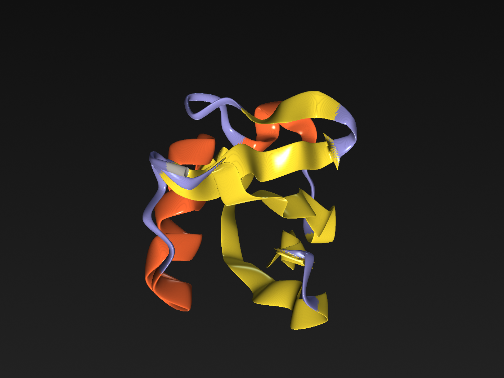
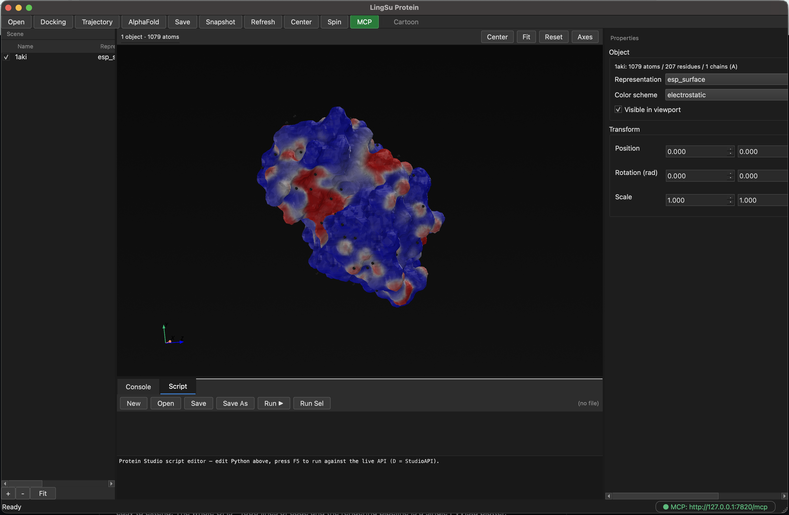
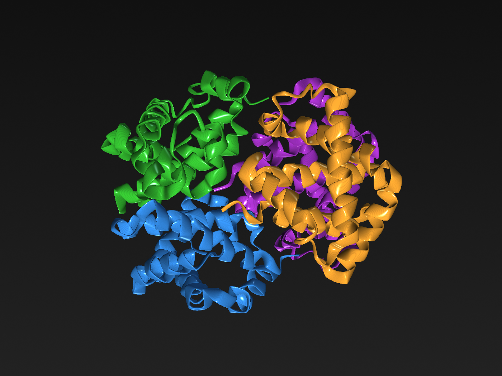
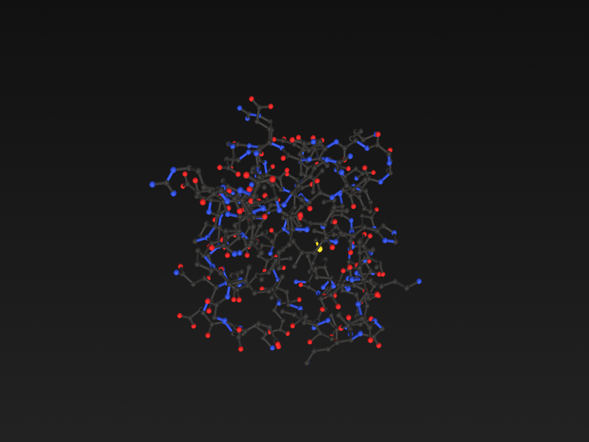
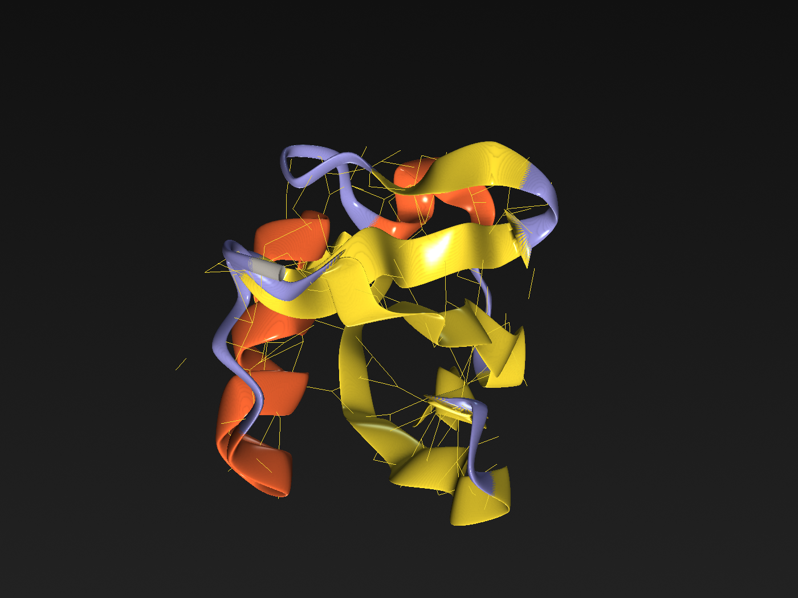
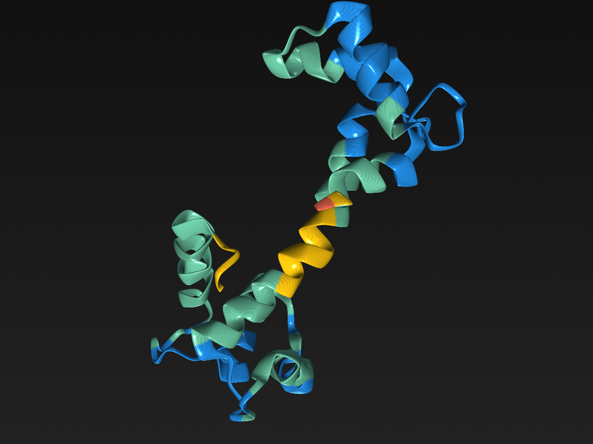
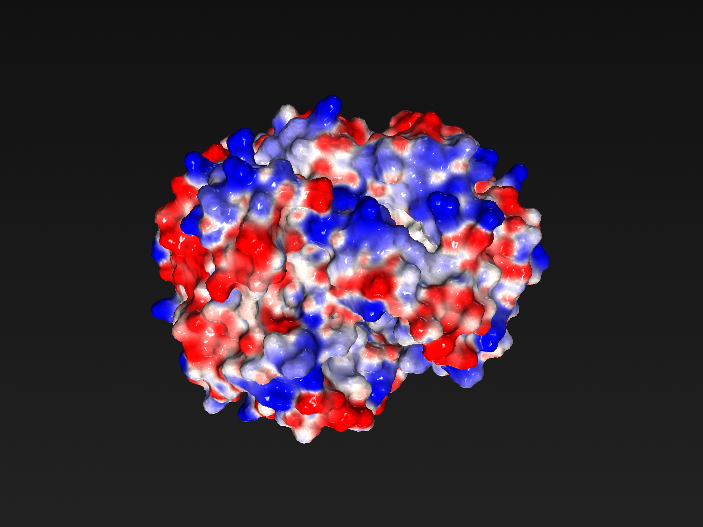
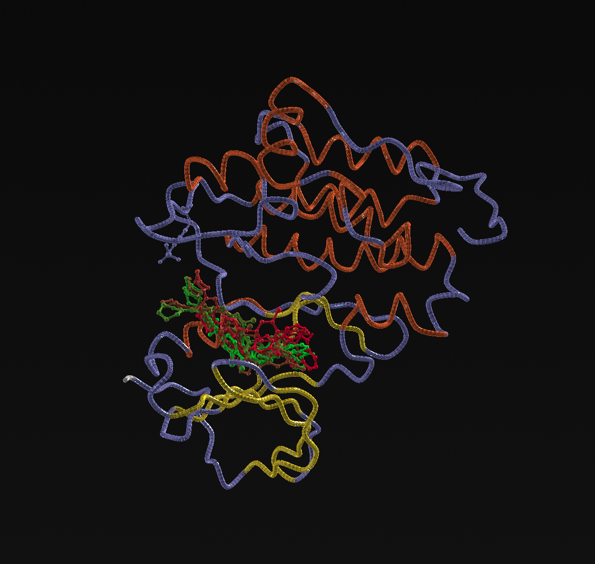

# Protein Studio

A Blender-like molecular visualization and editing desktop application
with an embedded Python scripting console — built on **PySide6 + PyVista
+ VTK**.





## Why?

Pymol, ChimeraX, VMD and Blender+Molecular Nodes are all great tools.
Protein Studio is an experiment in keeping the *scriptability* of
Blender (every operation has a Python binding) while staying
self-contained, easy to read, and easy to extend. The whole UI is ~1000
lines of code and the rendering pipeline is a single PyVista plotter.

## Features

- **PDB loading** (ATOM / HETATM / HELIX / SHEET / multi-model).
- **Seven representations** — `cartoon`, `ball_and_stick`, `ribbon`,
  `surface`, `points`, **`esp_surface`** (red-white-blue
  electrostatic), **`hbonds`** (dashed lines).
- **Seven color schemes** — `element`, `residue`, `chain`, `secondary`,
  `bfactor`, `uniform`, **`alphafold_plddt`** (royal-blue / cyan /
  amber / brick-red AlphaFold palette).
- **Distance measurement** between any two atoms via
  `D.distance(obj, chain_a, resnum_a, name_a, chain_b, resnum_b, name_b)`.
- **MD trajectories** (DCD / XTC / NC / TRR) via MDAnalysis —
  `D.load_trajectory(name, top, traj)` then `D.frame(name, i, obj)`.
- **AlphaFold / Boltz-2** automatic pLDDT colouring via
  `D.load_alphafold(path)`.
- **Docking poses** — Vina PDBQT and EquiScore directory auto-detect,
  per-pose rank-based colouring via `D.load_docking(path)`.
- **Blender-like layout** — Outliner (left), Viewport (centre),
  Properties (right), Python Console (bottom).
- **Embedded Python console** — full access to a `D` object that
  exposes load / save / mutate / render operations.
- **Headless mode** — render a single frame to PNG without launching
  the GUI.
- **Object-level transforms** — per-object position / rotation / scale.
- **Secondary-structure inference** — DSSP-like classification from backbone
  N···O hydrogen bonds, so `secondary` colouring works even on PDB files
  that carry no `HELIX`/`SHEET` records.
- **Free-energy perturbation (FEP)** — OpenMM-backed λ-sweep with BAR
  estimation, four shipped recipes (`quick_test`, `production_bar`,
  `benchmark_mutation`, `benchmark_ligand`), checkpoint/resume, and an
  `Analyze` tab with per-window plots.
- **MCP server** — drive the viewer from an AI agent over stdio or HTTP:
  5 scene tools (`load_pdb`, `load_docking`, `load_alphafold`,
  `set_representation`, `set_scheme`) plus 12 `fep_*` tools for building
  systems, running sweeps, resuming from checkpoints and comparing against
  reference ΔG values.

## Quick start

```bash
# 1. Create a Python 3.10+ environment
conda create -n protein-studio python=3.12 -y
conda activate protein-studio

# 2. Install
pip install -e .

# 3. Run
protein-studio                              # empty scene
protein-studio examples/1ubq.pdb            # auto-load ubiquitin
protein-studio examples/1ubq.pdb --headless # render one frame and quit
```

### Optional feature sets

The core install is enough for loading, colouring, representations, surfaces
and the embedded console. The heavier features live behind extras so that a
plain `pip install -e .` stays light:

```bash
pip install -e ".[trajectory]"   # MD trajectories (MDAnalysis)
pip install -e ".[mcp]"          # MCP server for agent control (mcp, uvicorn)
pip install -e ".[fep]"          # free-energy perturbation (OpenMM)
pip install -e ".[all]"          # everything above
pip install -e ".[dev]"          # pytest + coverage
```

Each optional dependency is imported lazily and raises a clear `ImportError`
with installation instructions if it is missing.

## Screenshots

| Ribbon (secondary-structure colours) | Haemoglobin (ribbon, chain colours) | Ball-and-stick (CPK element colours) |
| --- | --- | --- |
|  |  |  |

| Hydrogen bonds (yellow) | AlphaFold pLDDT colouring | ESP surface (red-white-blue) |
| --- | --- | --- |
|  |  |  |

| Docking poses (rank-coloured) |
| --- |
|  |

### Regenerating the figures

Every figure above is rendered by the current representation code, so the
documentation cannot drift away from the implementation:

```bash
python scripts/render_readme_images.py            # all figures
python scripts/render_readme_images.py ubiquitin  # only matching names
python scripts/render_readme_images.py --list     # show the table
```

The script uses the same three-point light rig as the running application and
renders polymer-only structures without HETATM records (waters, ligands,
ions), so the figures stay free of clutter. The AlphaFold figure is a real
prediction from the AlphaFold Protein Structure Database
(`examples/AF-P0DP23-F1.pdb` — calmodulin-1, UniProt P0DP23).

The application opens with three panels around a 3D viewport:

```
┌─ File Edit Render View Help ──────────────────────────────┐
├─ Toolbar: Open Save Snapshot Refresh Center ───────────────┤
├──────────┬─────────────────────────────┬──────────────────┤
│          │                             │                  │
│ Outliner │       3D Viewport           │   Properties     │
│          │                             │                  │
│          │                             │                  │
├──────────┴─────────────────────────────┴──────────────────┤
│  >>> D.load("examples/4hhb.pdb")                           │
│  >>> D.objects[0].representation = "ball_and_stick"        │
│  >>> D.objects[0].color_scheme   = D.scheme("chain")       │
│  >>> D.refresh()                                           │
└────────────────────────────────────────────────────────────┘
```

## Python scripting

The bottom console runs a full Python interpreter (not a sandbox).
`D` is bound to a `StudioAPI` instance that exposes the whole
application:

```python
>>> D.scene.n_objects(), D.scene.n_atoms()
(1, 1230)
>>> D.objects[0].representation
'cartoon'
>>> D.objects[0].color_scheme.key
'secondary'

# Switch representations
>>> D.set_representation(D.objects[0].name, "ball_and_stick")
>>> D.set_scheme(D.objects[0].name, "chain")
>>> D.refresh()

# Add multiple objects
>>> D.load("examples/1ubq.pdb", name="ubq")
>>> D.load("examples/4hhb.pdb", name="hgb", representation="ball_and_stick", scheme="element")

# Direct molecule access (numpy-friendly)
>>> u = D.objects[0].molecule
>>> ca_coords = u.coords([a for r in u.residues for a in r.atoms if a.name == "CA"])
>>> ca_coords.shape
(76, 3)

# Compute RMSD between two chains
>>> import numpy as np
>>> ubq = D.find("ubq").molecule
>>> hgb = D.find("hgb").molecule
>>> a = ubq.coords([a for r in ubq.residues for a in r.atoms if a.name == "CA"])[:76]
>>> b = hgb.coords([a for r in hgb.residues for a in r.atoms if a.name == "CA"])[:76]
>>> rmsd = np.sqrt(((a - b) ** 2).sum(axis=1).mean())
>>> print(f"RMSD(CA) = {rmsd:.2f} Å")
```

Available color schemes: `uniform`, `element`, `residue`, `chain`,
`secondary`, `bfactor`, `alphafold_plddt`.
Available representations: `cartoon`, `ball_and_stick`, `ribbon`,
`surface`, `points`, `esp_surface`, `hbonds`.

### AlphaFold / Boltz-2 pLDDT

```python
>>> obj = D.load_alphafold("path/to/AF_prediction.pdb")
>>> D.plddt_summary(obj.name)
{'mean_plddt': 82.6, 'buckets': {'very_high': 80, 'confident': 220, ...}}
```

The AlphaFold palette is auto-applied: very-high (royal blue),
confident (teal), low (amber), very-low (brick red).

### Electrostatic surface + hydrogen bonds + distance

```python
>>> obj = D.load("examples/1ubq.pdb")
>>> D.set_representation(obj.name, "esp_surface")   # red/white/blue ESP
>>> D.set_representation(obj.name, "hbonds")       # dashed lines for H-bonds
>>> D.refresh()
>>> D.distance(obj.name, "A", 1, "N", "A", 76, "C")
Distance(N ↔ C): 67.812 Å
>>> D.detect_hbonds(obj.name)                       # returns list[HBond]
[HBond(donor=..., acceptor=..., distance=2.91, angle_deg=159.4), ...]
```

### MD trajectories

```python
>>> traj = D.load_trajectory("ubq_traj", "examples/1ubq.pdb", "examples/ubq.dcd")
>>> D.load("examples/1ubq.pdb", name="ubq_frame", representation="cartoon")
>>> D.frame("ubq_traj", 0,  "ubq_frame")   # snap to first frame
>>> D.frame("ubq_traj", 10, "ubq_frame")   # advance
```

### Docking poses

```python
>>> poses = D.load_docking("results/equiscore_out")    # directory of PDBs
>>> # Each pose becomes its own scene object, colour by rank.
>>> for p in poses:
...     print(p.rank, p.score, p.ligand.name)
1 -7.3 ligandA
2 -6.8 ligandA
3 -6.1 ligandA
```

Auto-detects Vina PDBQT (`MODEL/ENDMDL` blocks with `REMARK VINA RESULT`)
and EquiScore-style directories (with optional `scores.txt`).

## Architecture

```
src/protein_studio/
├── app.py                    # CLI / QApplication entry point
├── api.py                    # StudioAPI exposed to the console as `D`
├── mcp_server.py             # MCP server (stdio + HTTP) for agent control
├── mcp_qt_server.py          # MCP server running on the GUI thread
├── mcp_bridge.py             # MCP ↔ GUI-thread dispatch bridge
├── resources.py              # resource resolution (icons, data files)
├── core/
│   ├── molecule.py           # Atom / Residue / Chain / Molecule dataclasses
│   ├── io.py                 # PDB parser/writer
│   ├── colors.py             # CPK / residue / SS / chain / AlphaFold palettes
│   ├── secondary.py          # DSSP-like SS inference from backbone H-bonds
│   ├── charges.py            # Gasteiger partial charges + ESP sampling
│   ├── hbonds.py             # H-bond detection + distance measurement
│   ├── surface.py            # EDTSurf-style SES / SAS / VDW surface
│   ├── marching_cubes.py     # marching-cubes wrapper (scikit-image)
│   ├── trajectory.py         # MDAnalysis trajectory wrapper
│   ├── alphafold.py          # pLDDT extraction + summary
│   ├── docking.py            # Vina PDBQT + EquiScore pose parsing
│   ├── representations.py    # PyVista mesh builders (incl. esp_surface, hbonds)
│   ├── scene.py              # Scene + SceneObject + change events
│   ├── fep.py                # OpenMM FEP engine (λ-sweep, BAR, checkpoints)
│   ├── fep_recipes.py        # named FEP parameter presets
│   ├── fep_reference.py      # reference ΔG library + comparison
│   ├── fep_checkpoint.py     # checkpoint save / resume
│   └── fep_mcp.py            # FEP operations exposed as MCP tools
└── ui/
    ├── main_window.py        # Blender-like layout
    ├── viewport.py           # PyVista interactor wrapper
    ├── outliner.py           # Left-side scene tree
    ├── properties.py         # Right-side property panel
    ├── console.py            # Embedded Python REPL
    ├── editor.py             # PDB editing
    ├── fep_panel.py          # FEP Setup / Run / Analyze tabs
    ├── fep_analyze.py        # FEP result analysis
    ├── fep_plots.py          # FEP plotting widgets
    └── mcp_controller.py     # MCP control panel
```

The whole rendering pipeline is one PyVista plotter; every
representation is a pure-Python function returning a `pyvista.PolyData`,
which makes adding new representations (electrostatics, surfaces,
density maps, …) trivial — drop a new function in
`core/representations.py` and register it in `REPRESENTATIONS`.

## Testing

```
pytest tests/
```

## Third-party components

The following upstream projects are used as dependencies; each remains under
its own license and is **not** covered by this project's license.

| Component | License |
| --- | --- |
| PySide6 / Qt for Python | LGPL-3.0 (or Qt Commercial) |
| PyVista, VTK | MIT / BSD-style |
| NumPy, SciPy | BSD-3-Clause |
| scikit-image | BSD-3-Clause |
| MDAnalysis | LGPL-2.1 |
| 3Dmol.js | BSD-3-Clause |
| Example structures in `examples/` | RCSB PDB (CC0); AlphaFold DB prediction (CC0) |

Parts of `core/secondary.py`, `core/charges.py`, `core/surface.py` and
`core/representations.py` are **ported from 3Dmol.js**
(© 2014 University of Pittsburgh and contributors, BSD-3-Clause). Those files
carry the full upstream copyright notice inline, as the BSD-3-Clause license
requires — please do not remove it.

3Dmol.js itself is **not** vendored in this repository and is **not** a runtime
dependency; it was only the upstream reference while the algorithms were being
ported. Nothing you install needs it.

## Citation

If you use Protein Studio in academic work, please cite the project:

```bibtex
@software{protein-studio,
  author  = {Xie, Zhengwei},
  title   = {Protein Studio: A Blender-like molecular viewer with an embedded
             Python scripting console},
  version = {0.3.0},
  url     = {https://github.com/kekegg/protein-studio}
}
```

If an associated paper is published later it will be listed in this section —
please cite that work as well when it is available.

## License

**Academic Research Use License 1.0** — free for academic research, education
and non-commercial scholarly work; **commercial use requires prior written
permission**.

- English (authoritative): [`LICENSE`](LICENSE)
- 中文对照译本（仅供参考，冲突以英文版为准）: [`LICENSE.zh-CN.md`](LICENSE.zh-CN.md)

In short: you may use, study, modify and redistribute it for academic work,
and publish the figures you produce. You may **not** use it for commercial
purposes, sell it, or use it inside a commercial product without written
permission from the author. Redistribution must keep the license, keep the
third-party notices, and mark your changes.

> ⚠️ Protein Studio is a **research and visualization tool**. It is not a
> medical device and is not approved for any diagnostic, therapeutic or
> regulatory purpose. Structures, representations, surfaces, distances and
> energies it produces must be independently validated before you rely on
> them.

## Disclaimer

Provided "AS IS", without warranty of any kind. See Sections 9–11 of the
license for the full warranty disclaimer, limitation of liability and
regulatory status.
